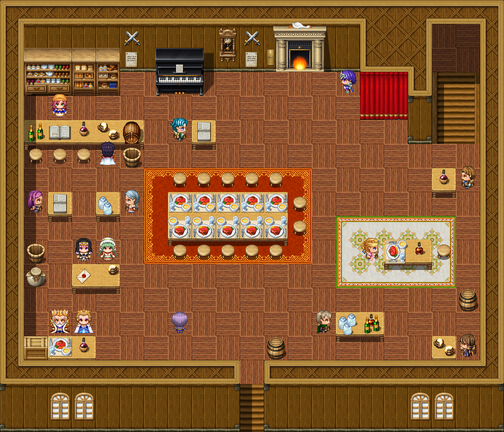

# The Slain Wyvern

This article is about the tavern at Nether Sopping. For the creature over the mantel, see <a href="../Bestiary/The_Goose">The Goose</a>, in Miss Halloway's Bestiary. For its sister house, see <a href="The_Gilded_Turnip">The Gilded Turnip</a>. For the back room, see <a href="../Institutions/The_Healers_Table">The Healers' Table</a>.

<table class="infobox">
<caption>The Slain Wyvern</caption>
<tr><td colspan="2" class="infobox-image">The bar, from above. The wyvern is over the fireplace</td></tr>
<tr><th>Known as</th><td>The Wyvern</td></tr>
<tr><th>Of</th><td><a href="Nether_Sopping">Nether Sopping</a>, on the front</td></tr>
<tr><th>Landlady</th><td>Dorcas Thrupp</td></tr>
<tr><th>Rooms</th><td>25, over 20, over 15, over a very faint 2</td></tr>
<tr><th>Breakfast</th><td>Fish. Don't ask what fish</td></tr>
<tr><th>Over the mantel</th><td>One wyvern (slain). (Goose.)</td></tr>
<tr><th>Plaques</th><td>Two, one either side of the fire. Neither mentions the other</td></tr>
<tr><th>Not permitted</th><td>Swords on the bar; spells in the bar; dragons in the bar, even small ones, even if it is a goose</td></tr>
<tr><th>Patrons</th><td>Retired adventurers, mostly; at capacity, eleven parties</td></tr>
<tr><th>Clock</th><td>Ten to twelve. Right twice a day</td></tr>
<tr><th>Also</th><td>My table, by the fire</td></tr>
</table>

The <b>Slain Wyvern</b> is the tavern on the front at <a href="Nether_Sopping">Nether Sopping</a>, kept by <b><a href="../People/Dorcas_Thrupp">Dorcas Thrupp</a></b>, and is where the heroes of the Obligatory Quest drink after they have been sent to the coast. Everybody in the room has been on one. It has a wyvern over the mantel, which is a goose, and a historian by the fire, who is me. I have done most of my life's work at that table, and most of the work in this volume, and when I say that the room would not tell a historian anything, I say it with great affection, and with the scars.

Its sign is a painted tankard, dented, with a bite out of one side. The bite is about the size and shape of a goose. The board outside reads THE SLAIN WYVERN. ROOMS. HOT FOOD. ONE WYVERN (SLAIN), and very small, at the bottom, where the paint has been scratched off and done again, (GOOSE).

## The wyvern

Mounted over the fireplace: a wyvern, wings out, jaws open, about the size of a large goose. It is, on any inspection at all, a goose. Under it is a brass plaque:

SLAIN BY H. VANCE, CHOSEN ONE #41, IN THE MARSHES, AFTER A LONG STRUGGLE.

<a href="../People/Halloran_Vance">Halloran Vance</a>, the Forty-First, came back from the marshes in 1940 with nothing, and a whole village waiting on the quay for a monster. So he brought them a monster. It took him two days, with wire, and a goose, and he never once smiled about it. "He was a good man," Dorcas says, "and he needed it to be a wyvern, and it's been a wyvern in my house for sixty years. So." For sixty years everybody agreed. Nobody in the room looks at it while you are looking at it, which is its own kind of answer.

In the year 2000 Miss <a href="../People/Wren_Halloway">Halloway</a> looked at it, and said what it was, and named it, *Anser anser*, greylag, adult female, with two bats' wings wired on and the whole thing varnished, and was asked to leave. She was entirely right, and she was asked to leave, and both of those were true at once. She asked, later, for a retraction, and was told no. She asked instead for a second plaque, one that would not correct the first and would not repeat it, and Dorcas said brass, not paper, this is a house, and that she would read it first. She read it twice. Then she fetched a screwdriver from behind the bar, and a chair, and put it up herself, on the other side of the fire:

A GREYLAG GOOSE, ANSER ANSER, OF A FARM ON THIS COAST. MADE INTO A WYVERN IN 1940, IN TWO DAYS, WITH WIRE, BY H. VANCE, CHOSEN ONE #41, BECAUSE THE VILLAGE WAS WAITING ON THE QUAY.

Somebody polishes both of them. Under the crossed swords there is a notice, NO DRAGONS IN THE BAR, EVEN SMALL ONES, and added later, EVEN IF IT IS A GOOSE. - D. THRUPP. There is a bucket by the fire marked FOR THE GOOSE. The goose has been on the wall since 1940. The bucket is filled every morning anyway. Nobody remembers who started it. Miss Halloway sits under the goose now, by choice, when she is in.

## The house

**Dorcas Thrupp** has kept the Wyvern for longer than she will say. Her sister <a href="../People/Prudence_Thrupp">Prudence</a> keeps the Gilded Turnip at <a href="Thistlewick">Thistlewick</a>, and they did not speak for thirty years, and sent each other things instead. The jar the Forty-Eighth brought south is on the highest shelf, where it can be seen from every table in the room. She has had a letter from her sister since, the first in thirty years, four pages, and two of them are about him. Rooms are twenty-five. For him they are still twenty-five; don't start. "It's the bedding I mind. You lot heal in it and it never recovers."

**Behind the bar**, bottles, each labelled in Dorcas's hand with what it is, how much it is, and who in this room it is not to be served to; every label has at least one name on it. Sopping biscuits, BAKED THIS MORNING, and very small, SOME MORNING. A jar of a thing that has been pickled for so long it has turned into a different thing, and is now quite happy. A ship in a bottle, with a tiny bottle on its deck, and in that a tinier ship. Somebody's tankard with a mat on top that says SAVED; by the dust, it has been saved since the spring. The tap, with a sign on it: HEROES WILL WAIT THEIR TURN LIKE EVERYBODY ELSE.

**The piano.** Every key has a name pencilled on it, somebody who sat at this bar and swore they could play. Most keys have two. Middle C has eleven, and one of them, in a child's writing, is SOPS. If you play the one tune you know, twenty retired adventurers will turn round at once, the way people do who have heard a trap click.

**The board** by the bar has the rooms down the left and names down the right. Room four has a line drawn through it. It has not been down since Tuesday. "Best guests I have ever had. No trouble. No noise to speak of. I leave the tray on the mat. Lovely to see newlyweds happy." **The house register** has a last column headed PURPOSE OF VISIT, and of forty entries on the page thirty-nine say *business*. The fortieth said something else, and has been crossed out, once, neatly, in Dorcas's hand, and *business* written above it. She has not made a fuss about it. I mention these only because they are on the board and the register, which are public documents, and I say nothing further about either.

**<a href="../People/Sops">Sops</a>** is the potboy, and will tell you that you look like a Chosen One, because of the standing. "Like you're waiting for someone to tell you where to go. All of 'em do it. Mrs Thrupp says it's the prophecy posture and it ruins the chairs." He picks the flowers for the bedrooms upstairs. They are mostly dandelions, arranged with enormous care.

**Upstairs** are the beds Dorcas sells. One has a card on the pillow: A CHOSEN ONE SLEPT HERE, and underneath, SO DID ALL THE OTHERS. IT IS THAT SORT OF INN. One has a dip in the middle exactly the shape of a man in full plate, which Dorcas has tried everything on; the bed remembers him. The clock on the landing chimes the quarters, except between three and four in the morning, which is when the adventurers get in. There are drawers of lost property (a monocle, a ring of keys to a castle in some other story, PLEASE RETURN) and a shelf of books left by guests. Among them, I am obliged to record, is Volume One of my history, which is a pamphlet. Volume Two is downstairs, and is the size of a door.

## The room

The patrons of the Wyvern are, mostly, people who went north with somebody, and came back, and were sent here, and have been here since, telling each other how it ended. The long table in the middle of the room is laid with a different meal from a different country at every place, and nobody has eaten a thing; they are all too busy. I give some of the room as it was in the year 2000.

* **<a href="../People/Ysolde_Marrow">Ysolde Marrow</a>**, seventy-eight at the time, who kept the <a href="../People/Ambrose_Fitch">Forty-Fourth</a> alive for nine years, on and off, and once, for nine weeks, a duke's son with four hit points. She sits at the table by the bar, and keeps a canvas roll of field medicine open on the table in front of her out of habit. One bottle in it is labelled FOR AFTER. It is tea. She chairs the Table in the back room.
* **<a href="../People/Hulda_Bole">Hulda Bole</a>**, the Fetcher, eleven years and four hundred and six jobs: "It wasn't FOR. It was a list. I was the legs." If anybody asks you to fetch twelve of anything, ask what the thirteenth is for.
* **<a href="../People/Nabb">Nabb</a> and <a href="../People/Tolly">Tolly</a>**, of the <a href="../People/Godfrey_Stopford">Forty-Sixth</a>'s party, who write to him every month. See <a href="The_Gloamwood">The Gloamwood</a>.
* **<a href="../People/Merrow_Halgate">Merrow Halgate</a>**, a big man in old armour, drinking carefully, of the party of twenty that fought the <a href="../People/Grimspite_the_Inevitable">Dark Lord</a> at the bridge and lost, as clause fourteen required. He has made his peace with losing. He has not made his peace with the paperwork. "He apologised. Halfway through, he stopped, and he apologised, and then he carried on."
* **<a href="../People/Councillor_Dree">Councillor Dree</a>**, an elderly gentleman who sits alone, deliberately, and was the kindly old advisor of his party, and was suspected, from week three, of not being, and was tied to a chair in week eleven and asked to reveal himself, and revealed that he needs spectacles. They bought him a hat.
* **<a href="../People/Perpetua_Small">Perpetua Small</a>**, a young woman with excellent posture and a tiara she does not appear to have noticed, who woke on the beach six years before the Quest with no memory and has been told nothing, very kindly, by the whole room, which wants to see her get there on her own. She folds every napkin into a little crown and does not know why. A bottle of very good wine with a crest arrives every month from a palace somewhere, addressed TO WHOM IT MAY CONCERN. It will come back to her. She expects it will be something dull. Dairy.
* **Two very ordinary travellers**, <a href="../People/Jack_Furrow">Jack Furrow</a> and <a href="../People/Jill_Furrow">Jill Furrow</a>, no relation, peasants, in peasant crowns, who have been in Nether Sopping four months, and are unacquainted, and met on the road yesterday, and are holding hands, and are beans people. Their table has two plates: one of beans, untouched; one of roast pheasant, eaten to the bone. Their luggage is a crate stencilled PEASANT LUGGAGE, with gold corners, and a little velvet cushion on top for sitting on. The town is starting to enjoy them.
* **The Forty-Second and his wife**, who come every year for the anniversary. Sops would like it known that they are sixty.
* **Corvin Ash**, who sat in the darkest corner of the room for eleven years, hood up, at the table where the light did not reach. He sits at a table in the middle of the room now. See <a href="../People/Corvin_Ash">his article</a>.
* **<a href="../People/Roland_Fairweather">Roland Fairweather</a>**, at his table by the fire, between engagements, lit very slightly better than the rest of the room. When he begins, Dorcas says "here we go".
* **Me**, at the table by the fire, with a book so large it has its own table. The page I had open when the Forty-Eighth first read over my shoulder was *Chapter Three Hundred and Twelve. The Forty-Eighth arrives, and stands about.* He said it was the most accurate thing anybody had written about him. The chapter before is called "Lunch".

## Six accounts

Volume Two of my history was compiled at that table, and finished, because the Forty-Eighth went round the room and was told: six first-hand accounts, heard properly, to the end. I describe the arrangement in <a href="../People/Hosea_Bellwether">my own article</a>, which I was made to write. Of all the <a href="../History/The_Chosen_Ones">Chosen Ones</a> who have stood in the Wyvern, he is the only one who sat down.

## The alumni

On one evening in the year 2000 the board carried a card, in a good square hand: THE FAIRWEATHER ALUMNI. DINNER, TONIGHT, THE SLAIN WYVERN. ALL PARTIES WELCOME. - F. ICKWORTH (DAME), WHO WAS FIRST.

Dame Florence Ickworth's party had done the Wyrm of Ickworth in 1977, with an eleven-year-old page who could already disarm her, and who left at the wyrm's door. She thought there might be three of them. There were eleven parties, and the Wyvern was at capacity. Brother Anselm of the Seven Bells; Mags Turvey, who fed him a fortnight on the walls of Wenlow and called him *our Roland*; Pim Corrow, the Lost Heir, whom he found; Captain Odile Marchbank of the Ninth Lancers, who had his whetstone; Old Jory, who drew the last mile of the Last Survey from his say-so; Hettie Brack, who got the Goblin King's last riddle, and the answer was *a door*; Lord Tobin Fairley-Vane, Ned Scarrow, Saul Pennock and Major Royce. By the end of the evening the whole room had worked it out, one table at a time, and had not said so: eleven last doors, each one finished without him, and every one of them had thought, until about an hour before, that he was theirs.

Dame Florence stood up. "We finished because you got us to the door, and taught us what to do on the other side of it." The room raised eleven glasses. *To Roland Fairweather, who got us all to the door.* Nobody said anything else at all. On the board there is still a dinner card signed eleven times, with a ring on it from somebody's glass.

## The back room

Behind the red curtain by the fire there is a door that most patrons have never noticed, with a card on it: THE TABLE. MEDICS ONLY. Behind it is a cellar room, a long table, a medicine shelf, and once a year every party medic within forty miles. Its business, and what Sister <a href="../People/Merribell">Merribell</a> said there, are under <a href="../Institutions/The_Healers_Table">The Healers' Table</a>. I am not on the list, and somebody inside says so.

I have been asked, by visitors who have read Volume Two, which table is mine. It is the one by the fire with the book on it. I have been asked whether they may sit at it. They may. I have been asked whether I will tell them a story. I tell them that everybody in this room has been on one, and that they should go round and be told. Most of them get two, and go and look at a dungeon.

## See also

- <a href="Nether_Sopping">Nether Sopping</a>
- <a href="The_Gilded_Turnip">The Gilded Turnip</a>
- <a href="../Bestiary/The_Goose">The Goose</a>
- <a href="../Institutions/The_Healers_Table">The Healers' Table</a>
- <a href="../People/Roland_Fairweather">Roland Fairweather</a>
- <a href="../People/Hosea_Bellwether">Hosea Bellwether</a>
