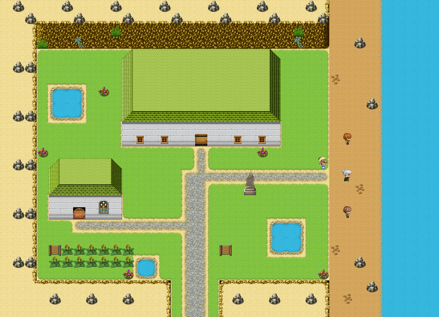

# Weeping Bottom

This article is about the valley and the Sisterhouse in it. For the Order, see <a href="../Institutions/The_Order_of_Whatever_Works">The Order of Whatever Works</a>. For the Sister who left it, and came back for an afternoon, see <a href="../People/Merribell">Merribell</a>. For the vigil kept in its chapel, see <a href="../People/Sir_Aldric_Pemberton-Gore_III">Sir Aldric Pemberton-Gore III</a>.

<table class="infobox">
<caption>Weeping Bottom</caption>
<tr><td colspan="2" class="infobox-image">Weeping Bottom, from above, in the drizzle</td></tr>
<tr><th>Known as</th><td>The Sisterhouse</td></tr>
<tr><th>Where</th><td>The bottom of a valley on the south coast, in a drizzle</td></tr>
<tr><th>Founded</th><td>1702, by Mother Ursula Pym, for the air</td></tr>
<tr><th>The air</th><td>Comes in off the sea, settles, and stays. It is very loyal</td></tr>
<tr><th>Orders</th><td>Two, until 2000: Whatever Works (west), and What Ought To Work (east)</td></tr>
<tr><th>Doctrine</th><td>Four lines, one about socks</td></tr>
<tr><th>Soup</th><td>Leek. It's always leek. It works</td></tr>
<tr><th>Symposia</th><td>Ten held. The eleventh not</td></tr>
<tr><th>Physic garden</th><td>Ferns</td></tr>
<tr><th>Knight in the field</th><td>Sir Hamo Tench, in bed, on the line</td></tr>
</table>

<b>Weeping Bottom</b> is a valley on the south coast with the Sisterhouse of the Order of Whatever Works in the bottom of it, founded in 1702 by <a href="../People/Mother_Ursula_Pym">Mother Ursula Pym</a> for the sea air, which is the finest cure for the chest in the opinion of every physician consulted, none of whom had been. It is the mother house of the Order. It drizzles there. It has been drizzling since about 1702.

## The valley

The founder's stone is beaded all over with damp, and the letters are cut deep, which is as well: THE SISTERHOUSE OF THE ORDER OF WHATEVER WORKS. FOUNDED 1702 BY MOTHER URSULA PYM, IN THIS VALLEY, FOR THE AIR. Under it, smaller: *The sea air being the finest cure for the chest, in the opinion of every physician consulted.* Under that, in a newer hand: *None of whom had been.*

The air comes in off the sea, settles in the bottom of the valley, and stays. On the shore **Sister Pim**, in a white cap and apron, lines up three patients twice a day and has them breathe it, in through the nose; it is prescribed, Founder's orders, and nobody has ever countermanded them, because it seemed rude, with her on the stone. Mr Crouch finds it lovely and bracing, and coughs, bracingly. Mrs Liddy came for the damp on her chest, and it is doing wonderfully; she has never had so much of it. Mr Oakes was only visiting, because his brother came in with a cough, in the spring, and his brother has gone home now, and Mr Oakes has it instead.

The Sisters planted a physic garden, with feverfew and sage and rosemary and comfrey. The valley grew ferns. Every plant in the garden is a fern, and they are doing splendidly. There are mushrooms on the path, the wall and a bench, and the Sisters stopped trying in about 1750; one of them has a very small bandage on it, because nobody goes untreated in Weeping Bottom. Through one window a Sister is hanging washing up indoors. It is the only way anything in Weeping Bottom ever gets dry, and it does not.

In the chapel window Mother Ursula holds up a pair of socks like a holy relic. They are dry. They are the only dry thing in any window in the Order.

## The line

The board at the gate reads WEEPING BOTTOM. THE SISTERHOUSE OF THE ORDER OF WHATEVER WORKS. VISITORS WELCOME. MIND THE STEP; IT IS WET. Painted in underneath, more recently and very neatly, in black: AND OF THE ORDER OF WHAT OUGHT TO WORK. (EAST DOOR.) There was one door.

In the year 2000 the ward was split down the middle by a line. The west half was Whatever Works', under **<a href="../People/Aveline_Stope">Prioress Aveline Stope</a>**, which had no doctrine; it had soup. The east half was What Ought To Work's, under **<a href="../People/Sister_Bewick">Sister Bewick</a>**, in the same white habit with every trim dyed black, which had a doctrine, and had been examined on it, and had passed. Over the line hung a notice: PATIENTS WILL KINDLY REMAIN IN THE HALF OF THE WARD TO WHICH THEY WERE ADMITTED. They did not. They walked across in the night, because they said there was soup. Sister Bewick had lost eleven that month, to the other half of the ward.

**Sister Lamb** ladled leek soup out of a pot the size of a bath on the west side. It is for everything: colds, falls, fevers. **Mr Nuttall** came in on the Tuesday with his arm, started on the east side, crossed on the Wednesday, and says it is much better on the west, where nobody asks you anything except whether you are warm. On the east side **Mr Dace** had a splinter, which Sister Bewick has in writing is how the ague starts, and was on the correct treatment, day four, and was looking wistfully across the line at the soup. Sister Bewick's *Correct Treatment of the Weeping Bottom Ague* is in eleven stages, each with its authority, and stage eleven reads *The patient will now feel better*, underlined twice. Her notes are in eleven volumes, one for each stage, and volume eleven is very thin. Toast was permitted at stage nine.

The Prioress held symposia. An order that holds one symposium is thinking, she says; an order that holds eleven has stopped. She said it the way a physician names a symptom she has seen before, in other people. The minutes of ten are on the table by the line, and every one ends the same way: *Resolved, that the matter be referred to the next symposium.* The eleventh, *Whether Anything Works*, was set for three o'clock, in the chapel, with the Prioress in the chair. The chairs are still in the chapel in two rows, facing one another, like a wedding where the families have not been introduced.

## The queue

The eleventh symposium was not held. Merribell, who had left the Sisterhouse at twenty-two because it had begun holding symposia, came back for an afternoon in the year 2000, and there was a queue at the gate, forty and more coming up the track, numbered, in the wet. Thirty-five, chest, it's the air. Thirty-six, not ill, Mum said to queue. Thirty-seven, knee, it's kept since Michaelmas. Thirty-eight, hoping for soup. Thirty-nine, doesn't know what it is, that's why there's a queue. Forty, last; somebody's always last; wet, an' all.

Merribell's proposal, which the Prioress laughed at, once, and which Sister Bewick wanted in writing immediately, and had, in eleven clauses, was: don't hold the symposium; open the door; twenty patients to each half, and whoever is through first is right. **<a href="../People/Sir_Hamo_Tench">Sir Hamo Tench</a>** kept the score from the bed on the line, which both orders treat, and is very fair.

Whatever Works was through its twenty while What Ought To Work was on patient one, stage eleven. Patient one was a fisherman, Mr Grebe, who had the Weeping Bottom ague, properly, the first case anybody had seen in nine years, and at stage eleven he sat up and felt better. Sister Bewick said, *It worked.* Merribell said of course it worked, he had it, and that was a point to the east, fair's fair. Nineteen to one, on points. Sir Hamo said it was very fair.

Sister Bewick asked to be examined on the Order's doctrine, since that is how a doctrine is settled. The Prioress took Mother Ursula's own pamphlet out of a drawer, where it had been since the first symposium: four pages, stitched, damp at the corners, with the Rule of Life on the first page. Sister Bewick read it twice, and was examined on it, and passed. She said that it was very short, and she could find nothing wrong with it, and that that was very annoying. There was soup on both sides of the line at three. She had some. She wrote in her notebook: *Intervention. Supported.*

The eleventh minute reads, in the Prioress's hand: *Not held. A queue instead. Whatever Works, on points. Soup.*

## Sir Hamo

Sir Hamo Tench, of the <a href="../Institutions/The_Order_of_the_Errant">Order of the Errant</a>, in the field, stands at the foot of the bed that is exactly on the line, in a nightshirt with a knight's surcoat over it. He came for the sea air sixteen years ago with a cough. Both lots treat him: soup at noon, correct treatment at four. The cough is exactly the same. Very fair. He writes to <a href="Coldbarrow">Coldbarrow</a> every quarter, IN THE FIELD, and it is true, too; they have a pin in him.

The Order's chapel for the west is across the yard. The Sisters lend it. For thirty years a shield hung over its door, inside, that nobody came for: a knight in a field, looking back over his shoulder, which the Sisters had always taken for a pun about vigilance. It was Sir Aldric's. He had been due to keep his vigil under it at sixteen, and kept it in the wrong chapel instead, eleven times, two of them Coldbarrow's Chapter House, which says CHAPTER HOUSE on the door and which he thought was being modest, and one of them a barn with a weathercock. In the year 2000 he kept it in the right one, dusk to dawn, with Sir Hamo standing sponsor and his friends keeping the watch, and something came in under the door at midnight. His article tells the rest. The shield is not over the door now. There is a paler patch on the wall, the shape of a shield.

I asked Merribell whether she would go back to Weeping Bottom. She said that she had been back twice since, to see the Prioress, and that they talk, now, and that the Sisterhouse holds no symposia, and that the patients sit down. Then she told me to drink a glass of water, and I did, and she watched me do it.

## See also

- <a href="../Institutions/The_Order_of_Whatever_Works">The Order of Whatever Works</a>
- <a href="../People/Merribell">Merribell</a>
- <a href="Sump">Sump</a>, which adopted the Rule as a by-law
- <a href="Coldbarrow">Coldbarrow</a>, where Sir Hamo's pin is
